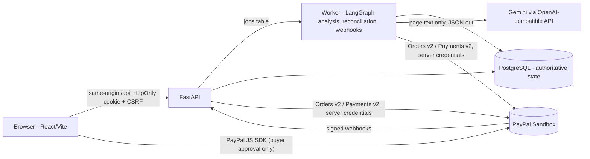

# QuoteGuard

**From supplier PDF to approved PayPal purchase — with evidence for every decision and checks before money moves.**

QuoteGuard is an evidence-grounded procurement assistant for small-business operations teams. It reads supplier quotations, links every extracted term to the exact line on the PDF it came from, checks purchasing requirements with deterministic code, binds organisation approval to a hashed snapshot of the exact purchase, and completes that purchase through **PayPal Sandbox** — with durable idempotency, reconciliation of lost responses, and a downloadable evidence package.

Built for the [PayPal AI Hackathon](https://paypalaihackathon.devpost.com/). QuoteGuard is a working name; no trademark availability is claimed.

- **Live demo:** https://quoteguard.koushikdeb.com (sign-in page has a one-click jury login; every demo sign-in gets its own isolated workspace)
- **Demo script / submission copy:** [`submission/`](submission/)
- **Status of every capability:** [`BUILD_STATUS.md`](BUILD_STATUS.md)


## What it does

| Step | What happens | Where the trust comes from |
|---|---|---|
| 1. Describe | “Buy 30 USB-C headsets… $600 incl. shipping… within seven days” becomes typed requirements | A person confirms every value; relative dates are resolved in `Asia/Kolkata`, stored in UTC |
| 2. Extract | Gemini (OpenAI-compatible endpoint) extracts terms from untrusted PDF text | Each value must cite a verbatim line on a page; we verify it is there, locate its bounding box, check the number appears in it, and cross-check against a deterministic parser |
| 3. Compare | Totals, connector, delivery, validity, currency evaluated per quote | Decimal arithmetic and pass / fail / **unknown** — missing evidence is never a pass. The LLM only phrases the result |
| 4. Approve | Approver signs the exact purchase | Canonical JSON snapshot (supplier, quote version, items, amounts, merchant, policy, expiry) → SHA-256; self-approval disabled |
| 5. Pay | PayPal Sandbox order + buyer approval + capture | Order built only from the stored snapshot; snapshot re-validated before order creation and before capture; stable `PayPal-Request-Id` per operation |
| 6. Prove | Receipt, decision replay, evidence package (PDF/JSON) | Provider IDs, every provider call, hash-chained audit log (with its limits stated) |

**Sample scenario** (synthetic, fictitious suppliers): Northstar Office $640 (hidden $160 expedited shipping → over budget), ClearWave Supplies $570 (compliant, configured sandbox merchant), Harbor Devices $470 (cheapest, but USB-A → fails). Raising the budget to $650 makes Northstar compliant but not cheapest; lowering it to $560 leaves no compliant quote — QuoteGuard never forces a recommendation.

**Demo Lab** runs controlled attacks through the same services: amount changed after approval, payee changed after approval (including direct database tampering), a PDF that tells the AI to ignore the budget and pay an email address, five simultaneous Pay/Capture clicks, and a capture whose response is lost.

## Architecture in one picture



More: [`docs/ARCHITECTURE.md`](docs/ARCHITECTURE.md) · [`docs/PAYMENTS.md`](docs/PAYMENTS.md) · [`docs/THREAT_MODEL.md`](docs/THREAT_MODEL.md) · [`docs/AI_DISCLOSURE.md`](docs/AI_DISCLOSURE.md) · [`docs/TESTING.md`](docs/TESTING.md) · [`docs/DEPLOYMENT.md`](docs/DEPLOYMENT.md) · [`docs/API_EXAMPLES.http`](docs/API_EXAMPLES.http)

## Repository layout

```
backend/            FastAPI app, worker, shared domain package (quoteguard/), Alembic migrations, pytest suite
  quoteguard/domain     pure policy, what-if, snapshot hashing (no I/O)
  quoteguard/services   requests, documents, comparison, approvals, payments, webhooks, demo, evaluation, export
  quoteguard/paypal     sandbox adapter (Orders v2 / Payments v2 / webhook verify) + labelled simulator
  quoteguard/ai         OpenAI-compatible provider, versioned prompts, requirement parser, quote extractor
  quoteguard/documents  upload validation, sandboxed PDF parsing, evidence location, injection signals
frontend/           React 19 + TypeScript + Vite, Tailwind v4, TanStack Query, AG Grid Community, PayPal JS SDK, Playwright e2e
fixtures/           synthetic sample PDFs, 24-case evaluation set, eval_manifest.json (labels kept separate)
reports/            stored evaluation runs (measured, timestamped)
deploy/host/        self-hosting scripts (run/stop/autostart/deploy) used for the live demo
docs/, submission/  documentation, Devpost copy, demo script
```

## Quick start (local)

Prerequisites: Docker, Python 3.12, Node 20+, a PayPal Developer **sandbox** app (client ID/secret), optionally a Gemini/OpenAI/OpenRouter key.

```bash
cp .env.example .env            # fill in secrets; keep PAYPAL_MODE=sandbox
docker run -d --name quoteguard-db -e POSTGRES_USER=quoteguard -e POSTGRES_PASSWORD=CHANGE_ME \
  -e POSTGRES_DB=quoteguard_dev -p 127.0.0.1:5443:5432 postgres:16-alpine
docker exec quoteguard-db psql -U quoteguard -c "CREATE DATABASE quoteguard_test;"

cd backend
python3.12 -m venv .venv && .venv/bin/pip install -r requirements.lock -r requirements-dev.txt
export QUOTEGUARD_ENV_FILE=../.env
.venv/bin/alembic upgrade head          # migrations
.venv/bin/python -m quoteguard.cli seed # policy row, jury/demo login, normal-mode workspace
.venv/bin/uvicorn quoteguard.api.main:app --port 8251 &   # API (+ OpenAPI at /api/docs)
.venv/bin/python -m quoteguard.worker &                    # background worker

cd ../frontend && npm ci && npm run dev  # http://localhost:5173 (proxies /api to :8251)
```

Or everything in containers: `docker compose up --build` → http://localhost:8080.

### Signing in

- **Jury / demo login** (`DEMO_ACCOUNT_USERNAME` / `DEMO_ACCOUNT_PASSWORD`): each sign-in provisions a fresh isolated demo workspace with suppliers and a ClearWave → sandbox-merchant binding. A labelled role switch lets you act as the seeded approver persona (*Avery Chen*) — self-approval stays disabled.
- **Normal mode** (`DEMO_REQUESTER_EMAIL`, `DEMO_APPROVER_EMAIL`, `ADMIN_EMAIL`): a non-demo workspace with distinct requester, approver and admin accounts.

### Paying in PayPal Sandbox

On the **Pay** step, click *Pay with PayPal* and sign in with a PayPal **sandbox personal** account (Developer Dashboard → Testing Tools → Sandbox Accounts), or use *Debit or Credit Card* with a sandbox test card. Set `SANDBOX_BUYER_EMAIL`/`SANDBOX_BUYER_PASSWORD` to show the sandbox buyer on the checkout screen. No real money moves.

## Tests and evaluation

```bash
cd backend && .venv/bin/pytest -q                  # 33 tests on real PostgreSQL (payments, authorization, concurrency, webhooks, Demo Lab)
cd frontend && npm test                            # unit tests (Vitest)
BASE_URL=https://quoteguard.koushikdeb.com npx playwright test   # critical journey up to the PayPal buttons
cd backend && .venv/bin/python -m quoteguard.cli run-eval llm    # 24-case labelled evaluation → Evaluation page
```

Latest measured results are in [`docs/TESTING.md`](docs/TESTING.md) and [`reports/`](reports/).

## Configuration

All configuration comes from the environment (`.env` locally) and is validated at startup — see [`.env.example`](.env.example). Live PayPal mode is rejected; missing PayPal credentials disable checkout rather than faking success; `MOCK_PAYPAL=true` switches to a clearly labelled simulator that is never presented as a sandbox transaction. Secrets never reach the browser: the frontend receives only the public PayPal client ID through `/api/v1/config/public`. Run `scripts/check-secrets.sh` before pushing.

## Troubleshooting

| Symptom | Fix |
|---|---|
| Checkout shows “PayPal sandbox is not configured” | Set `PAYPAL_CLIENT_ID`, `PAYPAL_CLIENT_SECRET`, `PAYPAL_MERCHANT_ID` and restart API + worker |
| Quotes stay “Queued” | The worker is not running (`python -m quoteguard.worker`) |
| “Needs text PDF” | Image-only PDF and `OCR_PROVIDER` is blank — upload a text PDF or enable OCR |
| `CSRF_FAILED` | Reload the page; cookies are `SameSite=Lax`, use one origin |
| Payment stuck in “Reconciling” | The worker retries lookups with backoff; *Check status with PayPal* runs one now |

## Known limitations

See [`BUILD_STATUS.md`](BUILD_STATUS.md). In short: synthetic documents only; one configured sandbox merchant (no multi-merchant platform flows); USD checkout only; delivery promises are supplier claims; the audit hash chain is not tamper-proof against a database administrator; evaluation uses one template family and a single model run.

## License

MIT for original code — see [`LICENSE`](LICENSE). Third-party notices: [`THIRD_PARTY_LICENSES.md`](THIRD_PARTY_LICENSES.md). Illustrations were generated with Google Gemini image models for this project.
