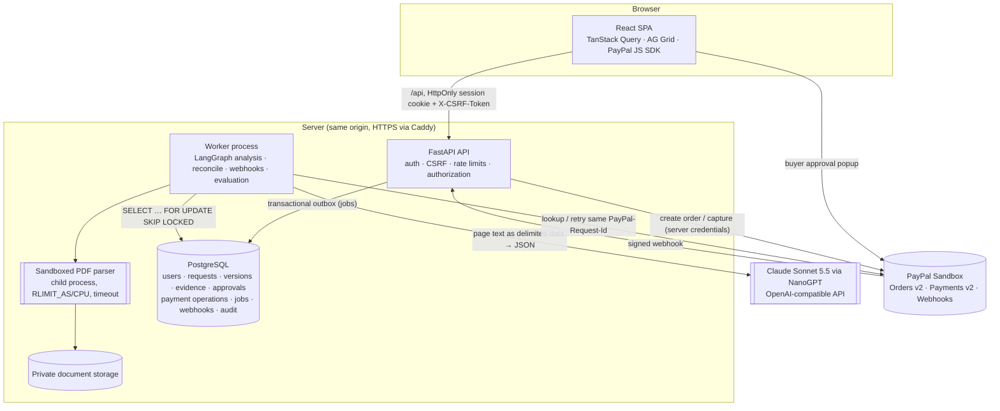

# Architecture

## Components

| Component | Responsibility |
|---|---|
| `quoteguard/domain` | Pure functions: requirement spec, policy evaluation (pass/fail/unknown), ranking, what-if, canonical snapshot hashing. No I/O, fully unit-testable. |
| `quoteguard/services` | Transactional business services used by **both** the API and the worker (and by Demo Lab): requests, documents, comparison, approvals, payments, webhooks, export, evaluation. |
| `quoteguard/paypal` | Provider adapter contract; `PayPalSandbox` (REST, sandbox base URL from a strict enum, OAuth token cached server-side) and a labelled `SimulatedPayPal` for tests and Demo Lab concurrency scenarios. |
| `quoteguard/ai` | OpenAI-compatible chat adapter with key rotation, timeouts, token limits, per-request call budget and call logging; versioned prompts; requirement parser; quote extractor with evidence verification. |
| `quoteguard/documents` | Upload validation (size, header, encryption, pages), isolated parsing, OCR hook, evidence location (word bounding boxes), suspicious-text signals, deterministic extractor. |
| `services/workflow.py` | LangGraph `StateGraph`: `extract_quotes → evaluate_constraints → summarize_recommendation`. Node progress is persisted in `workflow_runs`; outputs live in normal tables so a restarted run re-enters the graph and skips completed work. |
| Worker | Claims jobs with `FOR UPDATE SKIP LOCKED`, requeues stale jobs, sweeps in-flight payment operations into reconciliation after a crash. |

Approval and payment are **not** graph nodes and are not tools available to the model. They are authenticated, deterministic services.

## Trust boundaries

1. **Browser → API.** Everything the browser sends is untrusted. Mutations require a session cookie (HttpOnly, SameSite=Lax, Secure in hosting) and a matching `X-CSRF-Token`; request bodies use `extra="forbid"` so client-supplied amounts or payees are rejected; every object lookup is scoped by workspace and returns *not found* across workspaces.
2. **Documents → system.** PDF bytes are parsed in a resource-limited child process. Extracted text, filenames and OCR output are data: they are delimited in prompts, model output is schema-validated, every cited line is re-checked against the page, numbers must appear in their own evidence, and the deterministic parser cross-checks critical amounts. Supplier names in PDFs only *suggest* a supplier; checkout requires a human-confirmed link to a supplier whose merchant binding was configured by an admin.
3. **Model → system.** The model returns JSON only. It has no tools that reach HTTP, files, environment or payments; it cannot change totals or eligibility (computed by `domain/policy.py`), and generated explanations are discarded if they contradict the policy result.
4. **Server → PayPal.** Credentials stay in the backend. Orders are built from the stored approved snapshot; before capture the server fetches the order and validates `custom_id`, amount, currency and payee merchant ID.
5. **PayPal → server (webhooks).** Deliveries are stored first, verified with PayPal's `verify-webhook-signature` using the configured webhook ID, deduplicated by event ID, matched to a known operation, and applied only through an authoritative provider lookup — never by trusting the event body.

## Data model (abridged)

`users, workspaces, memberships, sessions` · `suppliers, merchant_bindings` · `purchase_requests, request_versions` · `documents, document_pages` · `quotes, quote_versions, quote_items, evidence_links` · `policy_versions, evaluations` · `workflow_runs, workflow_events` · `purchase_snapshots, approvals, approval_decisions` · `payment_operations, provider_transactions, refunds` · `webhook_events, jobs` · `audit_events` · `evaluation_runs, evaluation_cases` · `extraction_cache, ai_calls, demo_scenario_runs, simulated_provider_orders, rate_limits`.

Request, approval and payment states are separate columns with CHECK constraints. Key constraints: one live approval per request (partial unique index), one checkout operation per approval (unique), unique `PayPal-Request-Id` values and provider IDs, one active merchant binding per supplier, `merchant_bindings.environment = 'sandbox'`.

## Decisions

- **PostgreSQL jobs table instead of Redis** — durable, transactional with the intent it records, enough for this load.
- **Opaque server sessions instead of JWT** — revocable, and the acting persona is server state.
- **Page images rendered server-side (pypdfium2)** with bounding boxes from pdfplumber instead of shipping pdf.js — smaller client and no PDF parsing in the browser.
- **AG Grid Community** only; no enterprise license key required.
- **One OpenAI-compatible adapter** (live: Claude Sonnet 5.5 via NanoGPT; previously Gemini 2.5 Flash), so the provider changes with `AI_BASE_URL`/`AI_MODEL` only.
- **Forensics inside the sandboxed parser.** The same resource-limited child process that extracts text also records PDF metadata, the trailer document ID, earlier incremental revisions (re-parsed), opaque shapes drawn over text in content-stream order, and the font of every amount. `documents/integrity.py` turns that into findings and a cross-supplier provenance graph; the result is the `integrity` policy check (high → fail, medium → unknown). No model is involved in the verdict.
