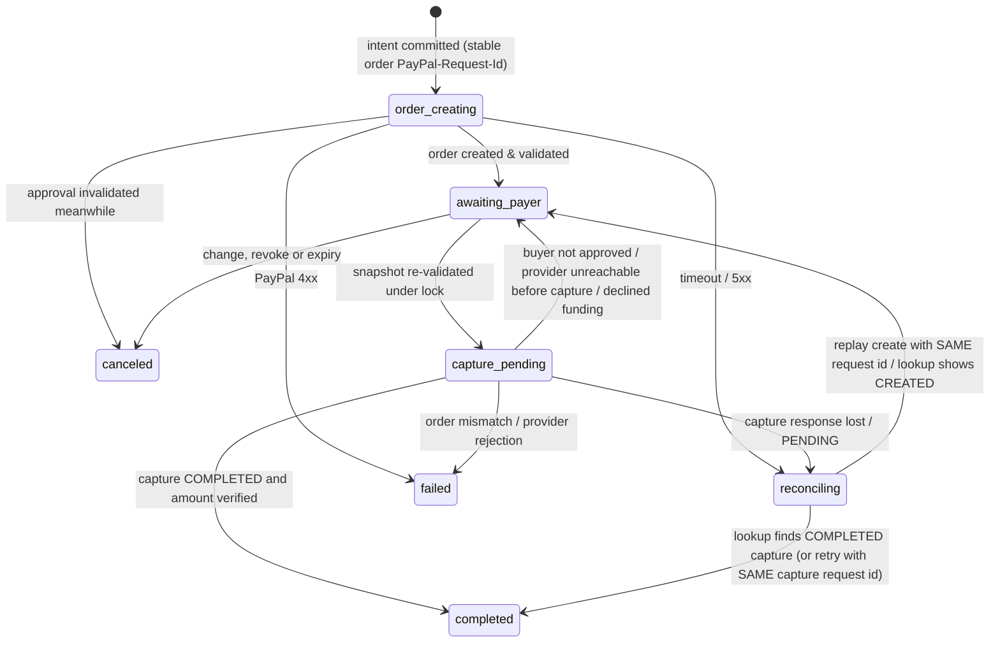

# Payments: states, sequence, retries and reconciliation

QuoteGuard uses the PayPal **Orders v2** API (`intent: CAPTURE`) from the backend and the official PayPal JavaScript SDK buttons in the browser for buyer approval. Live mode is disabled: the base URL comes from a strict enum that only contains `https://api-m.sandbox.paypal.com`.

## Separate state machines

| Object | States |
|---|---|
| Request | `draft → analyzing → needs_clarification / ready_for_review → approved`; `superseded`, `canceled` |
| Approval | `active → consumed_for_execution`; `expired`, `revoked`, `invalidated` |
| Payment operation | `not_started → order_creating → awaiting_payer → capture_pending → completed`; `reconciling`, `canceled`, `failed` |
| Refund (optional) | `pending → completed`; `reconciling`, `failed` (linked to the original capture) |

Legal payment transitions:



## Checkout sequence

```mermaid
sequenceDiagram
  participant U as Buyer (browser)
  participant A as QuoteGuard API
  participant D as PostgreSQL
  participant P as PayPal Sandbox
  U->>A: POST /approvals/{id}/checkout (no amount, no payee)
  A->>D: lock request → approval; re-build terms from DB; compare terms hash; check expiry & signature
  A->>D: INSERT payment_operation (business key, order/capture PayPal-Request-Ids); approval → consumed; COMMIT
  A->>P: POST /v2/checkout/orders (PayPal-Request-Id = order id) — built from the snapshot
  A->>D: store order id, state awaiting_payer
  A-->>U: order id → PayPal popup
  U->>P: buyer logs in and approves (QuoteGuard never sees credentials)
  U->>A: POST /payments/{op}/capture
  A->>D: lock request → approval → operation; re-validate snapshot; state capture_pending; COMMIT
  A->>P: GET order → check custom_id, amount, currency, payee, status APPROVED
  A->>P: POST /v2/checkout/orders/{id}/capture (PayPal-Request-Id = capture id)
  A->>D: store capture id + status; COMPLETED → completed
  P-->>A: webhook (verified, deduplicated) → authoritative lookup → no-op if already completed
```

## Idempotency and concurrency

- **Logical operation key.** `payment_operations.business_key = checkout:{approval_id}` and `UNIQUE(approval_id, kind)`: duplicate clicks resolve to the same row. A losing concurrent request returns the existing operation (`duplicate: true`).
- **Stable PayPal-Request-Ids.** Generated once per operation (`qg-order-…`, `qg-capture-…`) and persisted *before* the provider call; retries reuse them. A different logical operation (e.g. a refund) gets a different ID.
- **Row locks with one global order:** `purchase_requests → approvals → payment_operations`. All locking reads refresh rows (`populate_existing`) and payment operations also carry an optimistic `lock_version`.
- **No transaction is held during an external call.** Intent is committed first; the outcome is recorded in a second short transaction.
- **Snapshot freezing.** Changes that would alter the purchase (requirement version, quote correction, supplier link, merchant change) call `invalidate_for_request`, which takes the same locks: if a capture is in flight (`capture_pending`/`reconciling`) the change is refused with `PAYMENT_IN_PROGRESS`; if the payment is still awaiting the payer the operation is canceled. Independently, order creation and capture re-build the terms from the database and compare hashes, so even a change that bypasses the service layer (Demo Lab tampers with rows directly) is caught.

## Ambiguity and reconciliation

- Timeout, connection error or 5xx → `reconciling`, a `reconcile_payment` job is queued (exponential backoff). Never `failed`, never `completed` without evidence.
- Reconcile looks up the order: captures present → apply them (amount verified); `APPROVED` with a capture intent → retry capture with the **same** capture request ID; `CREATED` → back to `awaiting_payer`; `VOIDED` → canceled. A replacement order is never created because a capture timed out.
- If order creation itself was ambiguous, reconcile replays the create with the same order request ID — PayPal returns the same order.
- Worker restart: every 15 s the worker moves operations stuck in `order_creating`/`capture_pending` for more than 45 s into reconciliation (`recover_stuck`).
- Completed operations are never regressed by later webhooks or lookups.

## Webhooks

`POST /api/v1/webhooks/paypal` stores the raw body and PayPal transmission headers, deduplicates by event ID and returns 200 immediately. The worker verifies the signature with `POST /v1/notifications/verify-webhook-signature` and `PAYPAL_WEBHOOK_ID`; invalid deliveries are marked and ignored; transient verification errors are retried. Verified events must map to a known operation (order ID, or capture ID / `supplementary_data.related_ids.order_id`) and the expected payee; they trigger an authoritative lookup rather than applying the event body. Simulator events from the PayPal dashboard are not proof of a sandbox transaction: their verification semantics differ, so they are documented and tested separately (see TESTING.md).

## Refunds (optional, merchant admin)

`POST /payments/{op}/refund` locks the operation, sums pending + completed refunds, rejects amounts above the remaining captured balance (tested with concurrent requests), records the refund intent with its own `PayPal-Request-Id`, then calls `POST /v2/payments/captures/{id}/refund`. No escrow, holds or automatic refunds exist; Demo reset never refunds or recaptures.

## Error codes

`APPROVAL_EXPIRED`, `APPROVAL_REVOKED`, `SNAPSHOT_CHANGED`, `MERCHANT_CHANGED`, `MERCHANT_UNCONFIGURED`, `QUOTE_NEEDS_REVIEW`, `QUOTE_NOT_ELIGIBLE`, `UNSUPPORTED_CURRENCY`, `PAYMENT_IN_PROGRESS`, `PAYMENT_CANCELED`, `PAYMENT_FAILED`, `PROVIDER_REJECTED`, `REFUND_EXCEEDS_CAPTURE`, plus operation-level `last_error_code` values (`PAYER_NOT_APPROVED`, `BUYER_CANCELED`, `PROVIDER_UNAVAILABLE`, `INSTRUMENT_DECLINED`, `PROVIDER_PENDING`, `CAPTURE_RESULT_UNKNOWN`). Every error response carries a correlation ID.

## Contract notes

Endpoints, headers and fields were implemented against PayPal's REST reference (Orders v2 create/get/capture, Payments v2 capture refund, Notifications verify-webhook-signature, idempotency via `PayPal-Request-Id`) and confirmed against the sandbox on 31 Oct 2026: OAuth client-credentials, order creation with `PayPal-Request-Id`, and order lookup returning `purchase_units[0].payee.merchant_id` were exercised live, and on 1 Nov 2026 a full buyer approval → capture → verified webhook cycle completed (order `8J490246E38235409`, capture `6KR959288R730242A`). Note: India-registered sandbox merchants cannot receive this USD flow (`UNSUPPORTED_PAYEE_CURRENCY`); use US-region sandbox accounts. Capture and refund idempotency retention windows are provider-defined; QuoteGuard does not rely on them beyond retrying a single logical operation promptly.
